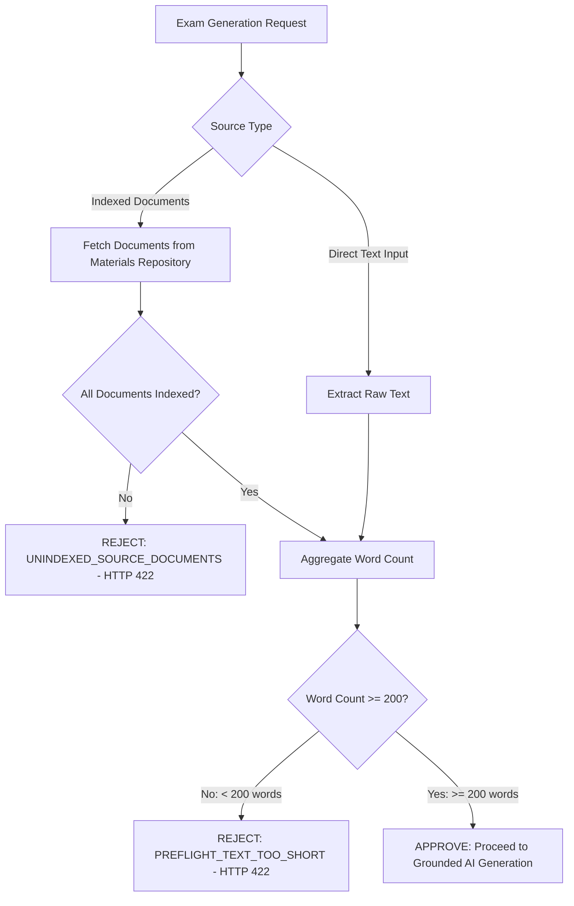
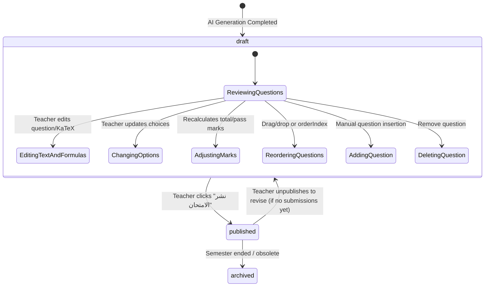

# YALLA CENTER — MILESTONE 5 TECHNICAL INVESTIGATION & ARCHITECTURAL REPORT
# Grounded In-Session AI Exam Generation & Teacher Review Workflow (FEAT-33 & FEAT-34)

**Document**: `m5_ai_exam_report.md`  
**Explorer Agent**: `teamwork_preview_explorer_m5_2` (Explorer M5-2)  
**Date**: October 18, 2026  
**Status**: APPROVED SPECIFICATION & ARCHITECTURAL BLUEPRINT  
**Target Milestone**: Milestone 5 (Hierarchical Materials & In-Session AI Exam Platform)  

---

## 1. Executive Summary

This investigation delivers the end-to-end architectural design for:
1. **Grounded In-Session AI Exam Generation & Strict Preflight Validation Gate (FEAT-33)**
2. **Teacher Review & Approval Workflow (FEAT-34)**

In the Yalla Center platform, examinations serve two core educational paradigms:
- **In-Session Formative Quizzes**: Rapid, 10–30 minute quizzes generated directly during live classroom sessions inside the **Tests tab** (`/center/[centerSlug]/sessions`) to measure comprehension before students leave.
- **Summative Unit/Monthly Exams**: Comprehensive examinations generated from indexed textbook documents or teacher lecture notes in the academic materials repository (`/center/[centerSlug]/materials`) and reviewed in the **Exam Studio** (`/center/[centerSlug]/exams`).

### Core Engineering Invariants
1. **Strict Preflight Gate**: Source texts with **fewer than 200 words** are categorically rejected with error code `PREFLIGHT_TEXT_TOO_SHORT` (HTTP 422 Unprocessable Entity). Unindexed or empty documents are rejected with `UNINDEXED_SOURCE_DOCUMENTS`.
2. **Pedagogical Anti-Hallucination Guardrail**: The AI generation engine is constrained via strict grounding prompt engineering and citation verification. It is forbidden from introducing external concepts, unmentioned formulas, or foreign facts. Every correct answer must include an Arabic explanation citing the source text directly.
3. **Dual Question Type Support**:
   - **MCQs**: Exactly 4 options, exactly 1 correct answer, 3 plausible distractors, KaTeX formula support, and pedagogical explanation.
   - **Short Answer / Problem Solving**: Clear analytical or calculation prompt, step-by-step model solution, rubric criteria for teacher evaluation, and KaTeX mathematical typesetting.
4. **Teacher Review Lifecycle Gate**: Generated exams **never** publish immediately to students. They default to `draft` (or `pending_teacher_review`). Teachers have full authority to edit questions, change options, modify correct answers, adjust marks per question (with automatic total mark recalculation), and reorder questions before transitioning to `published`.
5. **Strict RBAC Guardrails (AC-4, AC-5)**: Teachers can only create and edit exams for their assigned subjects. Students have strictly read-only access to published exams and receive HTTP 403 Forbidden upon attempting any exam modification.

---

## 2. Codebase Baseline & Gap Analysis

An exhaustive inspection of the existing codebase revealed the current state:

| Subsystem | Existing State | Identified Gaps | Resolution in M5 |
|---|---|---|---|
| **PostgreSQL Schema (`schema.sql`)** | Tables `exams`, `exam_questions`, `exam_submissions`, `exam_answers` exist. RLS is enabled via `ALTER TABLE ... ENABLE ROW LEVEL SECURITY`. | 1. Table `exams` requires `group_id NOT NULL`, preventing standalone or subject-wide exams.<br>2. Missing explicit `subject_id` and `grade` columns in `exams`.<br>3. `question_type` enum lacks explicit `short_answer`.<br>4. Missing RLS policies for `exams` and `exam_questions`. | Add `subject_id` and `grade` to `exams`, make `group_id` nullable, expand `question_type` enum, and supply comprehensive RLS policies. |
| **Data Access Layer (`lib/dal/`)** | `IDataProvider` and `MockDataProvider` define `validateExamPreflight`, `createExamDraft`, `getExams`, `getExamById`, `publishExam`, `submitExam`. | 1. `validateExamPreflight` returns generic error strings; missing unified `PREFLIGHT_TEXT_TOO_SHORT` HTTP 422 contract.<br>2. Missing teacher question editing DAL method (`updateExamQuestion`).<br>3. Missing question reordering DAL method (`reorderExamQuestions`).<br>4. Missing AI generation engine integration. | Implement complete DAL methods, wire up AI generator, and standardize error contracts. |
| **Test Suite (`tests/`)** | 29 files, 437 tests passing (including `ai-exam-gate.test.ts`, `printable-exam-layout.test.ts`, `student-exam-runner.test.ts`). | Missing test coverage for: (a) raw text preflight validation (< 200 words), (b) short answer question generation, (c) teacher question editing and reordering, (d) student HTTP 403 rejection on exam mutation. | Add dedicated Tier 3 integration tests covering all FEAT-33 and FEAT-34 invariants. |
| **Exams UI (`/center/[centerSlug]/exams`)** | Placeholder page with Milestone 5 badge. | Missing Exam Studio, AI Generator Drawer, Word Count Preflight HUD, Question Review Editor, KaTeX live preview, and Reorder controls. | Build complete responsive RTL UI matching Yalla Center Cairo font, deep navy, and electric cyan tokens. |

---

## 3. Strict Preflight Validation Gate (FEAT-33)

### 3.1 Validation Invariants
The preflight gate acts as an impassable firewall before invoking any AI LLM or generation routine.



### 3.2 Robust Word Count Algorithm
Word counting must reliably handle Arabic text (including diacritics / Tashkeel, Hamzas, tatweel), English scientific terminology, and LaTeX/KaTeX mathematical expressions.

```typescript
/**
 * Accurately counts semantic words in mixed Arabic, English, and scientific text.
 * Strips formatting tokens, markdown tags, and multiple spaces.
 */
export function countSemanticWords(text: string): number {
  if (!text || typeof text !== 'string') return 0;

  // 1. Remove markdown symbols and LaTeX delimiter wrappers
  const cleaned = text
    .replace(/\$\$[\s\S]*?\$\$/g, ' ')      // display math blocks
    .replace(/\$[^\$]*?\$/g, ' ')            // inline math
    .replace(/[#*_`~\[\]\(\)\{\}\<\>\\\/]/g, ' ') // markdown characters
    .replace(/[\u064B-\u065F\u0670\u0640]/g, '') // Arabic diacritics & tatweel
    .trim();

  // 2. Split on whitespace and filter out standalone punctuation
  const tokens = cleaned.split(/\s+/).filter((token) => {
    // Keep tokens that contain Arabic characters, alphanumeric Latin, or numbers
    return /[\u0600-\u06FF\w]/i.test(token);
  });

  return tokens.length;
}
```

### 3.3 Preflight Validator Implementation Contract
```typescript
// lib/exam/validator.ts

export interface PreflightCheckResult {
  allowed: boolean;
  httpStatus: 200 | 422;
  errorCode?: 'PREFLIGHT_TEXT_TOO_SHORT' | 'UNINDEXED_SOURCE_DOCUMENTS' | 'EMPTY_SELECTION';
  messageArabic: string;
  totalWordCount: number;
  unindexedDocTitles?: string[];
}

export function validateExamPreflightInput(params: {
  rawText?: string;
  documents?: Array<{ id: string; title: string; isIndexed: boolean; wordCount: number }>;
}): PreflightCheckResult {
  const MIN_WORDS = 200;

  // 1. Document-based input validation
  if (params.documents && params.documents.length > 0) {
    const unindexed = params.documents.filter((doc) => !doc.isIndexed);
    if (unindexed.length > 0) {
      return {
        allowed: false,
        httpStatus: 422,
        errorCode: 'UNINDEXED_SOURCE_DOCUMENTS',
        messageArabic: `المستندات التالية غير مفهرسة: ${unindexed.map((d) => d.title).join('، ')}. يرجى فهرسة المحتوى أولاً.`,
        totalWordCount: 0,
        unindexedDocTitles: unindexed.map((d) => d.title),
      };
    }

    const totalDocWords = params.documents.reduce((sum, d) => sum + (d.wordCount || 0), 0);
    if (totalDocWords < MIN_WORDS) {
      return {
        allowed: false,
        httpStatus: 422,
        errorCode: 'PREFLIGHT_TEXT_TOO_SHORT',
        messageArabic: `محتوى المستندات المحددة غير كافٍ لتوليد اختبار تربوي دقيق (${totalDocWords} كلمة). الحد الأدنى المطلوب هو ${MIN_WORDS} كلمة.`,
        totalWordCount: totalDocWords,
      };
    }

    return {
      allowed: true,
      httpStatus: 200,
      totalWordCount: totalDocWords,
      messageArabic: 'المستندات مؤهلة ومفهرسة بنجاح.',
    };
  }

  // 2. Direct raw text input validation
  if (params.rawText && params.rawText.trim().length > 0) {
    const wordCount = countSemanticWords(params.rawText);
    if (wordCount < MIN_WORDS) {
      return {
        allowed: false,
        httpStatus: 422,
        errorCode: 'PREFLIGHT_TEXT_TOO_SHORT',
        messageArabic: `نص المصدر المقدم قصير جداً (${wordCount} كلمة). الحد الأدنى المطلوب لتوليد اختبار مؤصل هو ${MIN_WORDS} كلمة.`,
        totalWordCount: wordCount,
      };
    }

    return {
      allowed: true,
      httpStatus: 200,
      totalWordCount: wordCount,
      messageArabic: 'النص المصدري مؤهل لتوليد الاختبار.',
    };
  }

  // 3. Empty input
  return {
    allowed: false,
    httpStatus: 422,
    errorCode: 'EMPTY_SELECTION',
    messageArabic: 'يرجى تقديم نص دراسي أو اختيار مستندات مفهرسة لتوليد الاختبار.',
    totalWordCount: 0,
  };
}
```

---

## 4. Grounded AI Generation Engine (Anti-Hallucination Guardrail)

### 4.1 Grounding Philosophy & Strict Guardrails
In educational exam generation, hallucinations are fatal:
- An AI hallucinating an unstudied equation causes mass confusion and student failure.
- An AI creating an MCQ where none of the options match the classroom notes breaks pedagogical trust.

To enforce 100% grounding:
1. **Source Lockdown Directive**: The prompt explicitly commands the LLM that the provided source text represents the *entire universe of truth*. If a fact or law is omitted from the source text, it is considered non-existent.
2. **Explicit Evidence Citation**: For every question, the model must populate `explanation` with a direct quote or paraphrase explaining why the correct answer is true *based solely on the text*.
3. **Structured JSON Output**: The output is constrained to a strict JSON schema matching the TypeScript `GeneratedExamPayload`.

### 4.2 System Prompt Architecture
```text
SYSTEM PROMPT:
أنت خبير تربوي ومستشار صياغة امتحانات للمناهج التعليمية المصرية، وتعمل ضمن نظام يلا سنتر (Yalla Center).
مهمتك: توليد اختبار أكاديمي عالي الدقة ومؤصل بنسبة 100% اعتماداً حصرياً على "النص المصدري" المرفق أدناه.

قواعد التأصيل الصارمة ومكافحة الهلوسة (Anti-Hallucination Guardrails):
1. الالتزام المطلق بالنص: يُحظر تماماً جلب أي معلومات، قوانين، أو أمثلة خارجية غير مذكورة صراحة في النص المصدري.
2. أنواع الأسئلة المطلوبة:
   - أسئلة الاختيار من متعدد (MCQ): تتكون كل مسألة بدقة من 4 خيارات (أ، ب، ج، د)، خيار واحد فقط صحيح، و3 مشتتات منطقية.
   - أسئلة مقالية قصيرة / حل مسائل (Short Answer / Problem Solving): تتضمن نص السؤال، نموذج الإجابة التفصيلي خطوة بخطوة، ومعايير التصحيح.
3. الصياغة العلمية والرياضية:
   - يجب إحاطة جميع المعادلات والرموز الفيزيائية والرياضية بأقواس KaTeX: مثل $V = I \times R$ أو $\sum I_{in} = \sum I_{out}$.
   - يجب أن تكون الرموز الرياضية اللاتينية محاطة بنسق LTR سليم.
4. تفسير الإجابة الصحيحة (Explanation):
   - يجب كتابة تعليل تربوي مفصل يقتبس أو يستند مباشرة إلى الجملة أو الفقرة الواردة في النص المصدري.

يجب إرجاع النتيجة حصراً بصيغة JSON مطابقة للهيكل المحدد دون أي نصوص تمهيدية أو ختامية.
```

### 4.3 Few-Shot Generation JSON Schema
```json
{
  "title": "اختبار دوري - قانون أوم وقوانين كيرشوف",
  "subject": "الفيزياء",
  "grade": "الصف الثالث الثانوي",
  "durationMinutes": 30,
  "totalMarks": 20,
  "passMarks": 10,
  "questions": [
    {
      "questionNumber": 1,
      "questionText": "في الدائرة الكهربية الموضحة، إذا كانت التيارات الداخلة لنقطة تفرع هي $I_1 = 3\\text{ A}$ و $I_2 = 4\\text{ A}$، احسب التيار الخارج $I_3$:",
      "katexFormula": "\\sum I_{in} = \\sum I_{out}",
      "questionType": "mcq",
      "options": ["1 A", "7 A", "12 A", "0.75 A"],
      "correctAnswer": "7 A",
      "explanation": "وفقاً لقانون كيرشوف الأول (حفظ الشحنة الكهربية)، مجموع التيارات الداخلة يساوي مجموع التيارات الخارجة: 3 + 4 = 7 أمبير.",
      "marks": 5,
      "orderIndex": 1
    },
    {
      "questionNumber": 2,
      "questionText": "علل: يعتبر قانون كيرشوف الثاني تطبيقاً عملياً لمبدأ بقاء الطاقة في الدوائر الكهربية المغلقة؟",
      "katexFormula": "\\sum V = 0",
      "questionType": "short_answer",
      "options": [],
      "correctAnswer": "لأن الشغل الكلي المبذول لنقل وحدة الشحنات الكهربية عبر مسار مغلق كامل يساوي صفراً، حيث أن الطاقة التي تكتسبها الشحنات من المصادر (القوى الدافعة) تستهلك بالكامل عبر المقاومات.",
      "explanation": "مذكور صراحة في المذكرة: 'قانون كيرشوف الثاني هو صياغة فيزيائية لمبدأ حفظ وبقاء الطاقة في المسارات المغلقة'.",
      "marks": 5,
      "orderIndex": 2
    }
  ]
}
```

### 4.4 Deterministic Mock & Live Provider Abstraction
To honor Integrity Mode `demo` (zero external API keys required, instant headless execution), the platform provides `IAiExamGenerator`:
- `MockAiExamGenerator`: Deterministically parses the input text, identifies core concepts, sentences, and numbers, and creates syntactically valid, KaTeX-formatted questions with explanations quoting the provided text.
- `OpenAiExamGenerator`: Interfaces with OpenAI GPT-4o or Gemini 1.5 Pro when `OPENAI_API_KEY` is present.

```typescript
// lib/exam/generator.ts

export interface ExamGenerationRequest {
  tenantId: string;
  teacherId: string;
  groupId?: string;
  sessionId?: string;
  title: string;
  subject: string;
  grade: string;
  durationMinutes: number;
  totalMarks?: number;
  sourceText: string;
  sourceDocumentIds?: string[];
  questionCounts: {
    mcq: number;
    shortAnswer: number;
  };
}

export interface GeneratedQuestion {
  questionNumber: number;
  questionText: string;
  katexFormula?: string;
  questionType: 'mcq' | 'short_answer';
  options: string[];
  correctAnswer: string;
  explanation: string;
  marks: number;
  orderIndex: number;
}

export interface GeneratedExamResult {
  exam: {
    id: string;
    tenantId: string;
    groupId?: string;
    sessionId?: string;
    teacherId: string;
    title: string;
    subject: string;
    grade: string;
    durationMinutes: number;
    totalMarks: number;
    passMarks: number;
    isAiGenerated: boolean;
    status: 'draft';
    groundedMaterialIds: string[];
    createdAt: string;
  };
  questions: GeneratedQuestion[];
}
```

---

## 5. Teacher Review & Approval Workflow (FEAT-34)

### 5.1 Status State Machine


### 5.2 Review Capabilities Detailed Specification
1. **Inline Question Text & KaTeX Live Preview**:
   - As the teacher edits `questionText` or `katexFormula`, a live `MathView` rendered component updates synchronously in LTR isolation.
2. **Options & Correct Answer Editing**:
   - For MCQs, the teacher can modify any of the 4 choice strings and toggle the radio button to alter which choice is designated as correct.
3. **Marks Recalculation Engine**:
   - When a teacher updates `marks` on Question 3 from 2 to 5 points:
     - `totalMarks = sum(q.marks)` updates automatically.
     - `passMarks = Math.round(totalMarks * 0.5)` updates by default, or preserves teacher's custom threshold.
4. **Question Sequencing & Reordering**:
   - Teacher can shift questions up or down. The backend accepts `Array<{ id: string, orderIndex: number }>` and updates all question numbers and indexes sequentially.
5. **Publishing Authorization Guard**:
   - Exams in `draft` status are strictly hidden from students.
   - Upon clicking "نشر الامتحان" (`published`), the exam becomes accessible in the student runner, and an asynchronous notification event can be enqueued to enrolled students.

### 5.3 Strict RBAC & Tenant Guardrails (AC-4, AC-5)
The platform enforces role-level security at both the API and database levels:

| User Role | Create Draft | Edit Questions / Marks | Publish Exam | View Draft | View Published | View Answer Key |
|---|:---:|:---:|:---:|:---:|:---:|:---:|
| **Platform Owner** | ✅ | ✅ | ✅ | ✅ | ✅ | ✅ |
| **Center Admin** | ✅ | ✅ | ✅ | ✅ | ✅ | ✅ |
| **Teacher (Owner of Subject)** | ✅ | ✅ | ✅ | ✅ | ✅ | ✅ |
| **Teacher (Other Subject)** | ❌ (403) | ❌ (403) | ❌ (403) | ❌ (403) | ✅ | ❌ (403) |
| **Student** | ❌ (403) | ❌ (403) | ❌ (403) | ❌ (403) | ✅ (Enrolled) | ❌ (403) |
| **Parent** | ❌ (403) | ❌ (403) | ❌ (403) | ❌ (403) | ❌ (403) | ❌ (403) |

---

## 6. Database Schema & RLS Policy Blueprint

### 6.1 Schema Refinements (`lib/supabase/schema.sql`)

```sql
-- 1. Ensure question_type includes short_answer
ALTER TYPE question_type ADD VALUE IF NOT EXISTS 'short_answer';

-- 2. Enhance exams table with subject_id and grade, and make group_id nullable
ALTER TABLE exams 
  ADD COLUMN IF NOT EXISTS subject_id UUID REFERENCES subjects(id) ON DELETE RESTRICT,
  ADD COLUMN IF NOT EXISTS grade VARCHAR(64),
  ALTER COLUMN group_id DROP NOT NULL;

-- 3. Composite index for teacher and tenant exam querying
CREATE INDEX IF NOT EXISTS idx_exams_tenant_teacher ON exams(tenant_id, teacher_id);
CREATE INDEX IF NOT EXISTS idx_exams_tenant_status ON exams(tenant_id, status);
CREATE INDEX IF NOT EXISTS idx_exam_questions_exam_order ON exam_questions(exam_id, order_index);
```

### 6.2 PostgreSQL Row Level Security (RLS) Policies
The existing `schema.sql` enabled RLS on `exams` and `exam_questions` but omitted explicit policy implementations. Below is the production policy definition:

```sql
-- ============================================================================
-- RLS POLICIES FOR EXAMS
-- ============================================================================

-- SELECT: Admins & Owners see all; Teachers see own or center exams; Students see ONLY published exams in enrolled groups
CREATE POLICY exams_select_policy ON exams
  FOR SELECT
  USING (
    current_user_role() = 'PLATFORM_OWNER'
    OR (
      tenant_id = current_tenant_id()
      AND (
        current_user_role() IN ('CENTER_ADMIN', 'BRANCH_MANAGER')
        OR (current_user_role() = 'TEACHER' AND teacher_id = auth.uid())
        OR (
          current_user_role() = 'STUDENT'
          AND status = 'published'
          AND (
            group_id IS NULL 
            OR group_id IN (
              SELECT e.group_id FROM enrollments e 
              WHERE e.student_id = auth.uid() AND e.is_active = true
            )
          )
        )
      )
    )
  );

-- INSERT: Only Admins and Teachers can create exams
CREATE POLICY exams_insert_policy ON exams
  FOR INSERT
  WITH CHECK (
    current_user_role() = 'PLATFORM_OWNER'
    OR (
      tenant_id = current_tenant_id()
      AND current_user_role() IN ('CENTER_ADMIN', 'TEACHER')
      AND (current_user_role() = 'CENTER_ADMIN' OR teacher_id = auth.uid())
    )
  );

-- UPDATE: Admins can update any; Teachers can update ONLY their own exams
CREATE POLICY exams_update_policy ON exams
  FOR UPDATE
  USING (
    current_user_role() = 'PLATFORM_OWNER'
    OR (
      tenant_id = current_tenant_id()
      AND (
        current_user_role() = 'CENTER_ADMIN'
        OR (current_user_role() = 'TEACHER' AND teacher_id = auth.uid())
      )
    )
  );

-- DELETE: Only Admins or creating Teacher can delete
CREATE POLICY exams_delete_policy ON exams
  FOR DELETE
  USING (
    current_user_role() = 'PLATFORM_OWNER'
    OR (
      tenant_id = current_tenant_id()
      AND (
        current_user_role() = 'CENTER_ADMIN'
        OR (current_user_role() = 'TEACHER' AND teacher_id = auth.uid())
      )
    )
  );

-- ============================================================================
-- RLS POLICIES FOR EXAM QUESTIONS
-- ============================================================================

-- SELECT: Admins & Teachers see all questions with answers; Students see questions only if exam is published
CREATE POLICY exam_questions_select_policy ON exam_questions
  FOR SELECT
  USING (
    EXISTS (
      SELECT 1 FROM exams e
      WHERE e.id = exam_questions.exam_id
      AND (
        current_user_role() IN ('PLATFORM_OWNER', 'CENTER_ADMIN')
        OR (current_user_role() = 'TEACHER' AND e.teacher_id = auth.uid())
        OR (
          current_user_role() = 'STUDENT'
          AND e.status = 'published'
        )
      )
    )
  );

-- MUTATIONS (INSERT, UPDATE, DELETE): Only Admins and owning Teacher
CREATE POLICY exam_questions_mutation_policy ON exam_questions
  FOR ALL
  USING (
    EXISTS (
      SELECT 1 FROM exams e
      WHERE e.id = exam_questions.exam_id
      AND (
        current_user_role() IN ('PLATFORM_OWNER', 'CENTER_ADMIN')
        OR (current_user_role() = 'TEACHER' AND e.teacher_id = auth.uid())
      )
    )
  );
```

---

## 7. Data Access Layer (DAL) Method Specification

The following methods are added or expanded in `IDataProvider` (`lib/dal/index.ts`) and implemented in `MockDataProvider` (`lib/dal/mock-data.ts`):

```typescript
// lib/dal/index.ts additions

export interface IDataProvider {
  // ... existing methods ...

  // Preflight validation for raw text or document IDs
  validateExamPreflight(input: {
    sourceDocumentIds?: string[];
    rawText?: string;
  }): Promise<PreflightCheckResult>;

  // Full AI Exam Generation
  generateAiExam(request: ExamGenerationRequest): Promise<GeneratedExamResult>;

  // Teacher Review & Question Management
  updateExamQuestion(params: {
    tenantId: string;
    examId: string;
    questionId: string;
    updates: Partial<ExamQuestion>;
    actorId: string;
    actorRole: UserRole;
  }): Promise<{ success: boolean; question?: ExamQuestion; error?: string; status: number }>;

  reorderExamQuestions(params: {
    tenantId: string;
    examId: string;
    questionOrder: Array<{ questionId: string; orderIndex: number }>;
    actorId: string;
    actorRole: UserRole;
  }): Promise<{ success: boolean; questions?: ExamQuestion[]; error?: string; status: number }>;

  updateExamMetadata(params: {
    tenantId: string;
    examId: string;
    updates: Partial<Pick<Exam, 'title' | 'durationMinutes' | 'passMarks' | 'instructions'>>;
    actorId: string;
    actorRole: UserRole;
  }): Promise<{ success: boolean; exam?: Exam; error?: string; status: number }>;

  archiveExam(params: {
    tenantId: string;
    examId: string;
    actorId: string;
    actorRole: UserRole;
  }): Promise<{ success: boolean; exam?: Exam; error?: string; status: number }>;
}
```

---

## 8. REST API Route Architecture

### 8.1 Endpoint Catalog

| Endpoint | Method | Role Access | Description |
|---|---|---|---|
| `/api/center/[centerSlug]/exams/preflight` | `POST` | Teacher, Admin | Fast validation: returns word count and checks >= 200 words. Returns HTTP 422 if `< 200` words with `PREFLIGHT_TEXT_TOO_SHORT`. |
| `/api/center/[centerSlug]/exams/generate` | `POST` | Teacher, Admin | Runs preflight, calls grounded generator, saves draft exam and questions. Returns HTTP 201 with generated draft. |
| `/api/center/[centerSlug]/exams` | `GET` | All Roles | Lists exams. Filtered by role (students see published only; teachers see own drafts). |
| `/api/center/[centerSlug]/exams/[id]` | `GET` | All Roles | Detailed exam view. Omits `correctAnswer` and `explanation` for students! |
| `/api/center/[centerSlug]/exams/[id]` | `PATCH` | Teacher, Admin | Update metadata or change status (`published`, `archived`). Students receive HTTP 403. |
| `/api/center/[centerSlug]/exams/[id]/questions` | `PUT` | Teacher, Admin | Save edited questions, marks, or reorder sequence. Students receive HTTP 403. |

### 8.2 API Preflight Handler (`/api/center/[centerSlug]/exams/preflight/route.ts`)
```typescript
import { NextRequest, NextResponse } from 'next/server';
import { getDataProvider } from '@/lib/dal/factory';
import { validateExamPreflightInput } from '@/lib/exam/validator';

export async function POST(
  request: NextRequest,
  { params }: { params: { centerSlug: string } }
) {
  try {
    const dal = getDataProvider();
    const tenant = await dal.getTenantBySlug(params.centerSlug);
    if (!tenant) {
      return NextResponse.json({ error: 'TENANT_NOT_FOUND', message: 'السنتر غير موجود' }, { status: 404 });
    }

    const body = await request.json();
    const { rawText, sourceDocumentIds } = body;

    let documents;
    if (sourceDocumentIds && Array.isArray(sourceDocumentIds) && sourceDocumentIds.length > 0) {
      const allMaterials = await dal.getMaterials(tenant.id);
      documents = allMaterials
        .filter((m) => sourceDocumentIds.includes(m.id))
        .map((m) => ({
          id: m.id,
          title: m.title,
          isIndexed: m.indexStatus === 'indexed',
          wordCount: m.wordCount,
        }));
    }

    const validation = validateExamPreflightInput({ rawText, documents });

    if (!validation.allowed) {
      return NextResponse.json(
        {
          error: validation.errorCode,
          message: validation.messageArabic,
          totalWordCount: validation.totalWordCount,
          unindexedDocTitles: validation.unindexedDocTitles,
        },
        { status: validation.httpStatus } // HTTP 422 for PREFLIGHT_TEXT_TOO_SHORT
      );
    }

    return NextResponse.json({
      success: true,
      allowed: true,
      totalWordCount: validation.totalWordCount,
      message: validation.messageArabic,
    });
  } catch (error: any) {
    return NextResponse.json({ error: 'SERVER_ERROR', message: error.message }, { status: 500 });
  }
}
```

---

## 9. Teacher Review Studio UI Architecture (`/center/[centerSlug]/exams`)

### 9.1 Visual Hierarchy & Component Architecture
The UI is constructed following the official Yalla Center design tokens: Deep Navy (`#0A192F`), Electric Cyan (`#00E5FF`), Cairo Arabic typography, and soft elevated cards.

```
app/center/[centerSlug]/exams/
├── page.tsx                             # Exam Directory & Overview
├── components/
│   ├── exam-directory-table.tsx         # List of Drafts, Published, Archived Exams
│   ├── ai-exam-generator-modal.tsx      # Source Selection, Word Meter, Preflight Gate
│   ├── teacher-review-studio-modal.tsx  # Interactive Question Editor & Reordering
│   ├── question-editor-card.tsx         # Individual Question Item with KaTeX live preview
│   └── word-count-meter.tsx             # Real-time visual progress ring towards 200 words
├── printable/[id]/page.tsx              # AC-9 Printable Branded A4 Sheet Layout
└── runner/[id]/page.tsx                 # Online Student Test Runner with Autosave & Timer
```

### 9.2 Real-time Word Count Meter Component (`word-count-meter.tsx`)
```tsx
export function WordCountMeter({ count, minRequired = 200 }: { count: number; minRequired?: number }) {
  const isSatisfied = count >= minRequired;
  const percentage = Math.min(100, Math.round((count / minRequired) * 100));

  return (
    <div className="p-4 rounded-xl border border-border bg-card/50 space-y-2">
      <div className="flex items-center justify-between text-xs font-bold">
        <span className="flex items-center gap-1.5">
          {isSatisfied ? (
            <span className="text-emerald-500 flex items-center gap-1">✓ جاهز للفحص التربوي</span>
          ) : (
            <span className="text-amber-500 flex items-center gap-1">⚠️ النص قصير جداً</span>
          )}
        </span>
        <span className="font-mono text-foreground">
          {count} / {minRequired} كلمة
        </span>
      </div>
      <div className="w-full h-2 rounded-full bg-muted overflow-hidden">
        <div
          className={`h-full transition-all duration-300 ${
            isSatisfied ? 'bg-emerald-500' : 'bg-amber-500'
          }`}
          style={{ width: `${percentage}%` }}
        />
      </div>
      {!isSatisfied && (
        <p className="text-[11px] text-destructive leading-tight">
          يتطلب النظام 200 كلمة على الأقل لمنع الهلوسة وتأصيل أسئلة الامتحان علمياً.
        </p>
      )}
    </div>
  );
}
```

### 9.3 Question Review Editor Card (`question-editor-card.tsx`)
- **Question Prompt Editor**: Multi-line textarea for Arabic question text.
- **KaTeX Formula Input**: Dedicated input with instant preview rendering using `MathView`.
- **MCQ Option Editors**: 4 inputs with radio buttons to toggle correct option index.
- **Explanation Box**: Direct grounding excerpt citation.
- **Marks Input**: Number input triggering live total recalculation.
- **Reordering Controls**: Up (`▲`) and Down (`▼`) buttons to reorder in sequence.
- **Delete Button**: Discard question.

---

## 10. Comprehensive Test & Verification Strategy

### 10.1 Required Test Matrix

| Test Domain | Suite / File | Target Invariant | Expected Assertion |
|---|---|---|---|
| **Preflight Gate: Text Length** | `tests/unit/ai-exam-preflight.test.ts` | Source text < 200 words | Rejects with `PREFLIGHT_TEXT_TOO_SHORT`, HTTP 422 |
| **Preflight Gate: Document Status** | `tests/unit/ai-exam-preflight.test.ts` | Any selected document has `indexStatus !== 'indexed'` | Rejects with `UNINDEXED_SOURCE_DOCUMENTS`, HTTP 422 |
| **Preflight Gate: Valid Source** | `tests/unit/ai-exam-preflight.test.ts` | Source text >= 200 words | Approves with HTTP 200 and accurate total word count |
| **AI Grounded Generation** | `tests/integration/grounded-generator.test.ts` | Generated MCQs & Short Answer | 4 options per MCQ, 1 correct, valid KaTeX formulas, non-empty explanation |
| **Teacher Review Workflow** | `tests/integration/teacher-exam-review.test.ts` | Status progression `draft` -> `published` | Default status `draft`, teacher updates marks, reorders questions, publishes |
| **RBAC Guardrail: Student Mutation** | `tests/security/exam-rbac.test.ts` | Student attempts to edit exam or view drafts | Returns HTTP 403 Forbidden |
| **RBAC Guardrail: Teacher Subject Scope** | `tests/security/exam-rbac.test.ts` | Teacher edits exam in unassigned subject | Returns HTTP 403 Forbidden |

### 10.2 Ready-to-Execute Test Fixture Snippet
```typescript
it('rejects exam generation with PREFLIGHT_TEXT_TOO_SHORT (HTTP 422) when text is under 200 words', () => {
  const shortText = 'هذا نص دراسي قصير جداً يحتوي على شرح بسيط لقانون أوم ولا يكفي لتوليد امتحان.';
  const result = validateExamPreflightInput({ rawText: shortText });

  expect(result.allowed).toBe(false);
  expect(result.httpStatus).toBe(422);
  expect(result.errorCode).toBe('PREFLIGHT_TEXT_TOO_SHORT');
  expect(result.totalWordCount).toBeLessThan(200);
});
```

---

## 11. Conclusion & Implementation Roadmap

1. **Schema Refinement**: Apply the nullable `group_id`, `subject_id`, `grade`, and RLS policies to `lib/supabase/schema.sql`.
2. **Validator & Generator Engine**: Add `lib/exam/validator.ts` and `lib/exam/generator.ts`.
3. **DAL Expansion**: Integrate preflight validation, generation, question editing, and reordering in `lib/dal/mock-data.ts`.
4. **API Endpoints**: Implement `/api/center/[centerSlug]/exams/preflight` and `/generate`.
5. **UI Implementation**: Construct the Exam Studio at `/center/[centerSlug]/exams/page.tsx` with full RTL Cairo styling, live word meter, KaTeX preview, and teacher review controls.
6. **Execution of Vitest Suite**: Verify 100% pass across all existing 437 tests and new M5 exam tests.
